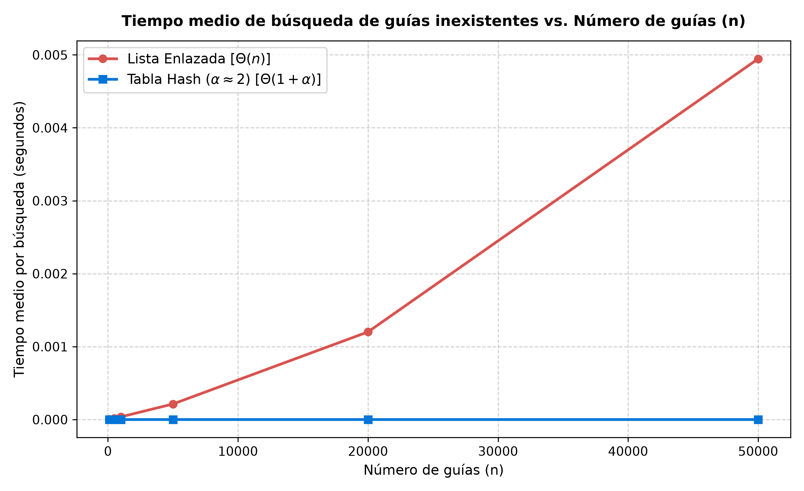
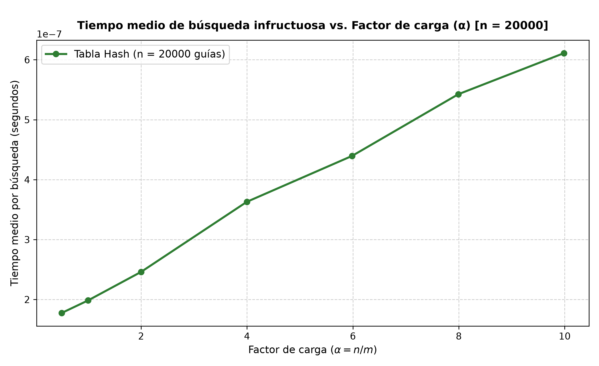

# Laboratorio 03 — Estructuras de Datos: Tablas Hash y Listas Enlazadas

**Estudiante:** Julian Esteban Suarez Gallego  
**Curso:** Análisis de Algoritmos  

---

## Instrucciones de reproducción

Para reproducir los resultados, ejecutar las pruebas de correctitud y generar las gráficas experimentales, ejecute desde la raíz del repositorio (`curso-analisis-algoritmos`):

1. **Activar el entorno virtual:**
   - En Windows (PowerShell):
     ```powershell
     .\.venv\Scripts\Activate.ps1
     ```
   - En Linux / macOS:
     ```bash
     source .venv/bin/activate
     ```

2. **Ejecutar las pruebas de correctitud (Parte 1):**
   ```bash
   python lab3-estructuras-datos/pruebas.py
   ```

3. **Ejecutar las mediciones y generar las gráficas (Parte 2):**
   ```bash
   python lab3-estructuras-datos/medicion.py
   ```
   Las figuras se guardarán automáticamente en `lab3-estructuras-datos/graficas/`.

---

## Parte 1 — Implementación y verificación de las estructuras

- [Implementación de estructuras: estructuras.py](estructuras.py)
- [Suite de pruebas de correctitud: pruebas.py](pruebas.py)

En `estructuras.py` se implementaron las clases `Nodo`, `ListaEnlazada` y `TablaHash` cumpliendo PEP 8, anotaciones de tipo y docstrings estilo Google. La lista enlazada realiza inserción en la cabeza en $\Theta(1)$ y búsqueda lineal iterativa en $\Theta(n)$. La tabla hash resuelve colisiones mediante encadenamiento asignando una `ListaEnlazada` a cada casilla y usa la función hash por división $h(k) = k \pmod m$, sin usar `dict`, `set` ni `hash()` de Python.

En `pruebas.py` se validó el comportamiento mediante `assert`:
- Búsqueda exitosa e infructuosa en lista y en tabla.
- Colisión forzada con $m = 7$ y las claves $10, 24, 17$ ($k \pmod 7 = 3$), comprobando inserción, búsqueda, que la casilla 3 contiene 3 nodos, las demás casillas están vacías y `factor_carga()` es exactamente $3/7$.
- Evaluación sobre 25 colecciones aleatorias de guías de diez dígitos, verificando que lista y tabla devuelven exactamente lo mismo ante claves existentes e inexistentes.

---

## Parte 2 — Medición y gráficas

- [Script de medición experimental: medicion.py](medicion.py)

Se usó una semilla fija para reproducibilidad y se cronometraron exclusivamente las búsquedas con `time.perf_counter()`. Para eliminar interferencias del sistema operativo, cada medición ejecutó 200 búsquedas inexistentes durante 5 repeticiones, seleccionando el menor tiempo medio. 

En el Experimento A se evaluaron 6 tamaños $n \in \{100, 500, 1000, 5000, 20000, 50000\}$ usando $m$ primo próximo a $n/2$ para fijar $\alpha \approx 2.0$ ($m \in \{53, 251, 503, 2503, 10007, 25013\}$). En el Experimento B se fijó $n = 20.000$ y se varió $m$ primo para evaluar 7 factores de carga $\alpha$ entre $0.5$ y $10.0$ ($m \in \{40009, 20011, 10007, 5003, 3343, 2503, 2003\}$).

### Gráfica 1 — Comparación de Lista Enlazada frente a Tabla Hash


### Gráfica 2 — Efecto del Factor de Carga en Tabla Hash


---

## Parte 3 — Análisis

### 1. Costo teórico
Buscar una guía inexistente en la lista enlazada cuesta $\Theta(n)$ porque el algoritmo recorre obligatoriamente los $n$ nodos hasta alcanzar `None`, realizando $n$ comparaciones y avances de puntero. 

En la tabla hash con encadenamiento, calcular la casilla mediante $h(k)$ toma $\Theta(1)$ y luego se recorre la lista de esa casilla. Bajo el **Supuesto de Hashing Uniforme Simple** (SUHA), cada clave tiene la misma probabilidad de caer en cualquiera de las $m$ casillas independientemente de las demás. La longitud esperada de cualquier lista es $\alpha = n/m$. Al buscar una clave inexistente se debe inspeccionar toda la lista de su casilla, lo que toma en promedio $\Theta(1 + \alpha)$ operaciones. Si todas las guías colisionaran en una única casilla, esa lista tendría longitud $n$ y las otras $m-1$ quedarían vacías. Toda búsqueda en dicha casilla degeneraría en un recorrido secuencial de $n$ elementos, colapsando el rendimiento a $\Theta(n)$, idéntico al de la lista enlazada.

### 2. Lo medido contra lo esperado
En la primera gráfica, comparando $n_1 = 20.000$ y $n_2 = 50.000$, el tamaño aumentó un factor de $2.5$. El tiempo de búsqueda en la lista enlazada pasó de $1.202\text{ ms}$ a $4.946\text{ ms}$ (se multiplicó por $4.11$), reflejando el orden lineal $\Theta(n)$ junto a mayores fallos de caché de CPU por el tamaño de los datos. En la tabla hash, el tiempo pasó de $0.257\,\mu\text{s}$ a $0.250\,\mu\text{s}$ (factor $0.97 \approx 1.0$), permaneciendo plano y ratificando la complejidad $\Theta(1)$, ya que $\alpha \approx 2$ se mantuvo constante.

En la segunda gráfica ($n = 20.000$), al crecer $\alpha$ desde $0.5$ hasta $9.98$, el tiempo medio aumentó linealmente desde $0.177\,\mu\text{s}$ hasta $0.611\,\mu\text{s}$. La curva describe una línea recta con pendiente positiva y un intercepto base ($\approx 0.15\,\mu\text{s}$, correspondiente al cálculo del hash e indexación del arreglo), lo cual es plenamente coherente con el modelo teórico $\Theta(1 + \alpha)$.

### 3. Explicación de colisiones
Una colisión ocurre cuando dos claves distintas satisfacen $h(k_1) = h(k_2)$. Sucede aun con más casillas que guías ($m > n$) debido a la **Paradoja del Cumpleaños**: la probabilidad de colisión depende del número de pares de claves $\binom{n}{2} \approx n^2 / 2$; basta que $n \approx \sqrt{m}$ para que supere el 50%.

Existen dos estrategias principales:
- **Encadenamiento:** Cada casilla contiene una lista enlazada. Permite $\alpha > 1$ y borrados directos en $O(1)$, pero introduce sobrecosto de memoria por punteros y menor localidad espacial.
- **Direccionamiento abierto:** Los elementos residen en el propio arreglo ($m \ge n$). Evita punteros y aprovecha la memoria contigua, pero no admite $\alpha \ge 1$, forma agrupamientos perjudiciales y exige marcas especiales ("lápidas") para borrar.

Con $m = 7$ y $h(k) = k \pmod 7$, las claves $10, 24, 17$ dan residuo 3. Con encadenamiento, se insertan en la lista de la casilla 3: $[17 \to 24 \to 10]$. En direccionamiento abierto lineal, 10 ocuparía la casilla 3, 24 la 4 y 17 la 5.

### 4. Tabla hash o árbol de búsqueda binario
Para el monitoreo por rango ("guías entre $X$ e $Y$"), la tabla hash **no sirve** porque la función hash dispersa deliberadamente las claves destruyendo todo orden, forzando a revisar todas las casillas y nodos ($\Theta(m + n)$). Un árbol de búsqueda binario (BST) mantiene las claves ordenadas y responde rangos recorriendo en orden los $k$ elementos en $\Theta(h + k)$, donde $h$ es la altura.

Si 400.000 guías llegaran ya ordenadas e insertadas una a una en un BST no balanceado, el árbol degeneraría en una lista simple con altura $h = 400.000$. Una búsqueda infructuosa requeriría $400.000$ comparaciones en el peor caso ($200.000$ en promedio). En cambio, un árbol equilibrado (AVL o Rojo-Negro) mantendría una altura de $\lceil \log_2(400.001) \rceil = 19$, resolviendo cualquier búsqueda en a lo sumo 19 comparaciones.

### 5. Concepto técnico para la jefa de operaciones
Se recomienda una **solución híbrida**: una tabla hash con encadenamiento ($\alpha \approx 0.75 - 1.0$) para resolver las consultas puntuales del call center en $\Theta(1)$, y un árbol balanceado (como B+ o Rojo-Negro) para los reportes por rango de operaciones en $\Theta(\log n + k)$, indexando ambos las mismas instancias de los envíos en memoria.

**Estimación analítica para 5.000.000 de envíos:**  
*Declaración:* Se trata de una estimación analítica basada en las mediciones empíricas y la complejidad teórica:
- **Lista Enlazada:** Al ser $\Theta(n)$, pasar de $50.000$ a $5.000.000$ representa un incremento de $100\times$. Con los $4.95\text{ ms}$ medidos para $n = 50.000$, una búsqueda inexistente tardaría aproximadamente $100 \times 4.95\text{ ms} \approx 495\text{ ms} \approx 0.50\text{ segundos}$. Ante cientos de operadores simultáneos, medio segundo bloqueando CPU por consulta colapsaría el sistema.
- **Tabla Hash:** Manteniendo $\alpha \approx 2$ redimensionando $m \approx 2.500.000$, la complejidad es $\Theta(1 + \alpha) = \Theta(1)$, independiente de $n$. La búsqueda de una guía inexistente continuará tomando aproximadamente **$0.25\,\mu\text{s}$** ($0.00000025\text{ s}$), ofreciendo una respuesta instantánea y escalable.
